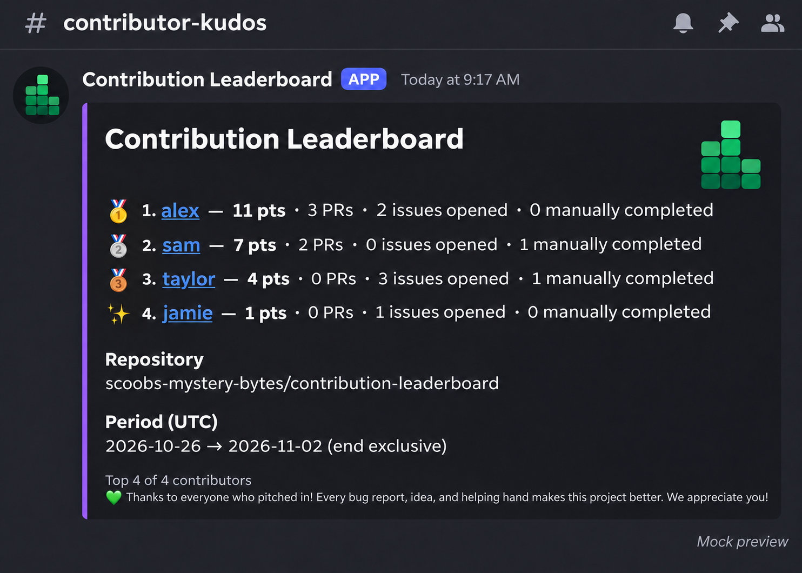

<p align="center">
  
</p>

# Description

Ever wanted to give your contributors a little extra kudos? 🎉 Contribution Leaderboard shines a light on the people helping your project grow, with scheduled shout-outs delivered straight to Discord. Celebrate the merged PRs, helpful issue reports, and contributions that keep things moving!

Every contribution deserves a thank-you. The leaderboard is a fun way to share appreciation, with room for everyone's pace and all the helpful work that numbers can't capture. 💚

Built as a TypeScript GitHub Action, it runs entirely on GitHub Actions. Set your schedule, connect a Discord webhook, and let the kudos roll in.

## Discord preview



This mock uses example contributors and a sample repository. The webhook's configured name and avatar appear on the actual post.

## Initial version

- Daily, weekly, monthly, quarterly, and custom month intervals.
- Choose a previous completed period, the current day, week, multi-week cycle, month, or all time independently of the posting schedule. Times use UTC; weeks start Monday.
- Merged PR authors: **3 points** each by default.
- Issue creators: **1 point** per issue opened during the reporting period, whether it is still open or has been closed.
- Manual issue completion: **1 point** to the human closer. Issues automatically closed by a PR or commit earn no extra completion points.
- Configurable weights, bot filtering, excluded users, and top contributor count.
- Discord embed, workflow summary, JSON output, and dry-run preview.
- Discord medal ranks: 🥇 first, 🥈 second, 🥉 third, and ✨ for everyone else. Tied scores sort alphabetically and use sequential positions.
- The green block logo appears as the embed's top-right thumbnail. It is uploaded with each post, so no image hosting is needed.

See [the step-by-step design](docs/design.md) for the full behavior and limitations.

## Set up

1. Create a webhook for the destination Discord channel under **Edit Channel → Integrations → Webhooks**.
2. In your GitHub repository, create an Actions secret named `CONTRIBUTION_LEADERBOARD_DISCORD_WEBHOOK_URL` containing that URL.
3. Copy [examples/leaderboard.yml](examples/leaderboard.yml) to `.github/workflows/leaderboard.yml` in your repository.
4. The example references `scoobs-mystery-bytes/contribution-leaderboard@v1`. For production, pin the action to a reviewed full commit SHA from a release.
5. Set `cadence`, `period`, and any other inputs below. Commit the workflow to the default branch.
6. Run the workflow manually with **dry-run enabled** and inspect the job summary.
7. Run manually with dry-run disabled to post, or let the schedule run.

The example checks daily at 08:17 UTC and defaults to a weekly post for the previous completed week. The action posts only on the UTC day selected by `cadence`. Manual runs bypass that day check and report the configured period; running again can post a duplicate. The 08:17 time is UTC and does not shift with your local daylight saving time.

## Inputs

| Input | Default | Purpose |
| --- | --- | --- |
| `github-token` | `${{ github.token }}` | Token with issues and pull requests read access |
| `discord-webhook-url` | — | Required for live posts; use an Actions secret |
| `repository` | `${{ github.repository }}` | One target repository, `owner/repo` |
| `cadence` | `weekly` | Posting schedule: `daily`, `weekly`, `monthly`, `quarterly`, `custom` |
| `period` | `previous` | Score window: `previous`, `day-to-date`, `week-to-date`, `weeks-to-date`, `month-to-date`, or `all-time` |
| `interval-weeks` | `3` | Weeks per score cycle for `weeks-to-date`, 1–520 |
| `anchor-week` | `2026-01-05` | Monday that aligns `weeks-to-date` resets, `YYYY-MM-DD` (2000–2099) |
| `interval-months` | `2` | Months between custom schedule boundaries, 1–120 |
| `anchor-month` | `2026-01` | Custom boundary anchor, `YYYY-MM` (2000–2099) |
| `top` | `10` | Maximum displayed contributors, 1–25; may be reduced to fit Discord limits |
| `pr-weight` | `3` | Points per merged PR, 0–1000 |
| `issue-weight` | `1` | Points to the human closer per manually completed issue, 0–1000 |
| `issue-created-weight` | `1` | Points per issue opened in the period, 0–1000 |
| `exclude-users` | empty | Comma-separated logins; case insensitive |
| `include-bots` | `false` | Include bot accounts |
| `dry-run` | `false` | Produce summary and outputs without contacting Discord |

A zero weight disables that metric in the ranking; at least one weight must be positive. Disabled metrics are still fetched, but their counts are not included in ranking entries.

### Posting schedule and score window

`cadence` controls which days a scheduled run posts; `period` controls what it counts. These settings are independent:

The daily `schedule` in the example workflow triggers the action; setting `cadence` alone does not create a schedule. Keep the daily trigger to support all the posting schedules below. To choose a different posting time, change its cron expression. All days and times below use UTC.

| `cadence` | Scheduled posting days |
| --- | --- |
| `daily` | Every day |
| `weekly` | Every Monday |
| `monthly` | The first day of each month |
| `quarterly` | January 1, April 1, July 1, and October 1 |
| `custom` | The first day of each month aligned with `anchor-month` and `interval-months` |

| `period` | What counts | When it resets |
| --- | --- | --- |
| `previous` | The completed calendar period matching the cadence | Each cadence boundary |
| `day-to-date` | From the start of the current UTC day through the run time | Every day at 00:00 UTC |
| `week-to-date` | From the current week's Monday through the run time | Every Monday at 00:00 UTC |
| `weeks-to-date` | From the start of the current anchored multi-week cycle through the run time | Every `interval-weeks` weeks, on Monday at 00:00 UTC |
| `month-to-date` | From the first of the current UTC month through the run time | First of each month at 00:00 UTC |
| `all-time` | All qualifying repository activity through the run time | Never |

Common combinations:

| Cadence | Period | Result |
| --- | --- | --- |
| `daily` | `all-time` | Daily post with a running score that never resets |
| `weekly` | `all-time` | Monday post with a running score that never resets |
| `daily` | `month-to-date` | Daily post with scores that reset on the first of the month |
| `weekly` | `month-to-date` | Monday post with scores that reset on the first of the month |
| `daily` | `week-to-date` | Daily post with scores that reset each Monday |
| `weekly` | `weeks-to-date` | Monday post with scores that reset every configured number of weeks |
| `monthly` | `previous` | First-of-month post celebrating the previous completed month |

For example, keep the daily workflow trigger and configure the action to post every Monday with a running monthly score:

```yaml
with:
  discord-webhook-url: ${{ secrets.CONTRIBUTION_LEADERBOARD_DISCORD_WEBHOOK_URL }}
  cadence: weekly
  period: month-to-date
```

Change `period` to `all-time` for scores that don't reset, or set `cadence: daily` to post every day. Set `cadence: monthly` and leave `period: previous` to post the prior completed month on the first of each month. A monthly `month-to-date` report instead starts fresh on that first day.

For weekly posts with scores that reset every three weeks:

```yaml
with:
  discord-webhook-url: ${{ secrets.CONTRIBUTION_LEADERBOARD_DISCORD_WEBHOOK_URL }}
  cadence: weekly
  period: weeks-to-date
  interval-weeks: '3'
  anchor-week: '2026-01-05'
```

`anchor-week` must be a valid Monday. It aligns resets in both directions; it does not delay activation or exclude earlier activity. With this example, windows start January 5, January 26, and February 16, 2026. The score resets at 00:00 UTC on each boundary, whether or not a post runs then. On a reset Monday, the scheduled post shows the **new** cycle as of posting time. Use `period: previous` with a weekly cadence to report the prior completed week; a completed multi-week report is not currently available. The reporting window and posting schedule are independent, so `weeks-to-date` does not make the action post every three weeks.

Scores are recalculated from GitHub at each run; there is no stored total. Reporting windows include the start and exclude the end. Ongoing windows end at the time the run starts, and skipped scheduled runs still produce their calculated period outputs. Historical data can change as issues are reopened, deleted, or closed again. All-time runs can require many API requests and may hit rate limits or the workflow timeout in large repositories.

Issue creation and manual completion are separate milestones. If Alice opens an issue and Bob's merged PR automatically closes it, Alice earns 1 point and Bob earns 3 for the PR; there is no additional issue completion reward. If a human manually completes an issue without a PR or commit causing the closure, that closer earns 1 point. Someone who both opens and manually completes an issue earns 2 points. Each milestone counts in the period when it happens. To recognize issue creation only, set `issue-weight: '0'`.

The action checks the latest closure event's source, rather than treating any linked or mentioned PR as the cause. PR and commit closures receive no completion credit, even if the PR is outside the reporting period or repository. A matching closure event with no PR or commit source is treated as manual. Missing or stale closure records receive no completion credit. Human completion credit uses GitHub's `closed_by` account. Bot closures and issues closed as not planned receive no completion points, even with `include-bots: 'true'`. That input still controls bot inclusion for PR and issue creation rewards. Pull requests are excluded from issue counts, even though GitHub's issues API returns them too.

```yaml
with:
  discord-webhook-url: ${{ secrets.CONTRIBUTION_LEADERBOARD_DISCORD_WEBHOOK_URL }}
  issue-created-weight: '1'
  issue-weight: '0'
```

For a post every other month, with a leaderboard for the preceding two months:

```yaml
with:
  discord-webhook-url: ${{ secrets.CONTRIBUTION_LEADERBOARD_DISCORD_WEBHOOK_URL }}
  cadence: custom
  period: previous
  interval-months: '2'
  anchor-month: '2026-01'
```

For every five months, use `interval-months: '5'`. The anchor keeps posting boundaries consistent across year boundaries. It establishes the alignment, not an activation date; boundaries also extend backwards from it. Set `period: month-to-date` or `period: all-time` to use a different scoring window with the same custom posting schedule.

The default token is scoped to the workflow repository. For another private repository, supply a separately authorized token with access to that repository. This version supports GitHub.com repositories.

## Outputs

| Output | Meaning |
| --- | --- |
| `period-start` | Inclusive UTC ISO timestamp |
| `period-end` | Exclusive UTC ISO timestamp |
| `leaderboard` | JSON array of all ranked entries; unset on skipped runs |
| `posted` | `true` after a successful Discord response, otherwise `false` |
| `skipped` | `true` when a scheduled run is outside a boundary day |

Entries contain `login`, `pullRequests`, `issuesCreated`, `issues` (issues manually completed by this account), and `score`. The workflow summary and Discord message display only the top entries.

## Scheduling limits

GitHub schedules can be delayed or dropped. Public repository schedules are disabled after 60 days without repository activity. This action does not persist delivery state, catch up missed days automatically, or prevent duplicate posts on reruns. A manual run reports the configured window at the time it runs; with `previous`, it can recover only the most recently completed period. Inspect Discord before retrying an uncertain delivery. See [GitHub's schedule documentation](https://docs.github.com/en/actions/reference/workflows-and-actions/events-that-trigger-workflows#schedule).

## Live test

To test this action from its own repository before publishing a release:

1. Create a webhook for a dedicated Discord test channel and save its URL as the repository Actions secret `CONTRIBUTION_LEADERBOARD_DISCORD_WEBHOOK_URL`.
2. Copy [examples/live-test.yml](examples/live-test.yml) to `.github/workflows/live-test.yml` and commit the action, its `dist/` bundle, and the image asset to the repository's default branch. The workflow checks out that branch and runs the local action; it does not require a published `v1` tag.
3. In the repository's **Actions** tab, run **Contribution Leaderboard Live Test** with `dry-run` enabled. Check the job summary for the target repository, reporting window, and scores.
4. Run it again with `dry-run` disabled. Check the test channel for the embed, thumbnail, and thank-you message, and compare its counts with GitHub. Manual runs can post duplicates; inspect the channel before retrying a failed or timed-out delivery.

The test workflow explicitly uses `cadence: weekly` and `period: previous`, so it reports the most recently completed UTC week for the repository where it runs. Change `period` in the test workflow to preview another score window; for `weeks-to-date`, set `interval-weeks` and `anchor-week` as needed. Discord receives that repository's contribution data.

## Development

Requires Node.js 24 and npm.

```sh
npm ci
npm run check
```

Commit the generated `dist/index.cjs` alongside source changes, and include `assets/images/contribution-leaderboard-logo.png` in releases. The bundled entry point loads that asset relative to its own location. Consumers run the bundled action directly and do not install dependencies. CI checks types, tests, and bundle consistency. No workflow posts to Discord in this repository by default.

## Release

Follow the [release checklist](docs/design.md#release-checklist) to prepare, publish, and maintain Marketplace releases.

## Contributing and license

Contributions are welcome! See [CONTRIBUTING.md](CONTRIBUTING.md). This project is licensed under the [MIT License](LICENSE); see [CHANGELOG.md](CHANGELOG.md) for changes.
