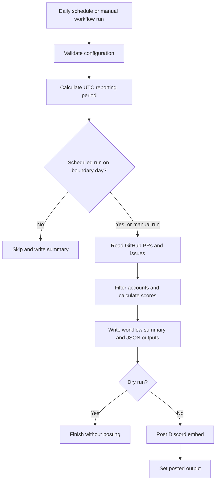

# Contribution Leaderboard: design and operating guide

## Goal

Give contributors a little extra kudos by sharing scheduled leaderboard shout-outs in Discord. The goal is to celebrate the people helping a project grow, respecting everyone's pace and recognizing that plenty of valuable work never appears in a score.

Publish the repository's leaderboard entirely through a reusable GitHub Action. Users configure a workflow and a channel webhook secret. The action does not require an external service or persistent database.

## Architecture

Implementation: TypeScript compiled to a committed Node.js 24 bundle; `@actions/core` handles inputs, outputs, secrets, and summaries; `@actions/github` provides authenticated Octokit REST calls; native `fetch` sends the Discord message.

## Step 1: configure the destination

The maintainer creates a Discord channel webhook and saves its URL as the `CONTRIBUTION_LEADERBOARD_DISCORD_WEBHOOK_URL` GitHub Actions secret. The workflow passes that secret to the action. A Discord bot token is unnecessary for channel posting.

The action masks the webhook URL and GitHub token in logs. It accepts HTTPS webhook URLs on `discord.com` or `discordapp.com`, and it omits Discord response bodies and URLs from delivery errors. Discord mentions are disabled in the payload.

Posting private repository activity to Discord shares that activity with the destination channel. Choose a channel whose membership is appropriate for the repository.

## Step 2: configure the workflow

Copy `examples/leaderboard.yml` into the consuming repository's `.github/workflows/` directory. Choose a released tag or existing commit SHA; the example's `v1` reference becomes usable after release. The workflow grants read access to contents, issues, and pull requests. No repository write permission is required.

The workflow runs once daily at 08:17 UTC, away from the start of the hour. Its default inputs are `cadence: weekly` and `period: previous`. The daily cron triggers the action; `cadence` filters those scheduled runs, so changing it without an appropriate workflow trigger does not schedule additional runs. The posting hour is UTC and does not follow local daylight saving time. A concurrency group prevents simultaneous executions of this workflow. It does not deduplicate sequential reruns. A 15-minute timeout bounds the job.

The example's manual trigger defaults to dry-run. Scheduled runs post live when due. Keep workflows that use secrets away from execution of untrusted pull request code.

## Step 3: determine the reporting window

The action uses UTC exclusively. Reporting windows include the start timestamp and exclude the end timestamp: `start <= event time < end`. Posting cadence and score window are independent. With `period: previous` (the default), the action reports the latest completed calendar period matching the cadence:

| Cadence | Boundary day | Reporting window |
| --- | --- | --- |
| Daily | Every day | Previous calendar day |
| Weekly | Monday | Previous Monday through Sunday |
| Monthly | First day of each month | Previous calendar month |
| Quarterly | January 1, April 1, July 1, October 1 | Previous calendar quarter |
| Custom | First day of each aligned month | Previous `interval-months` months |

For a custom cadence, convert the anchor and current month to integer month indices. Find the most recent boundary with `anchor + floor((current - anchor) / interval) * interval`. With `period: previous`, the report ends there and begins one interval earlier; other period values use their own score windows while retaining the same posting boundaries. This works across years, including intervals that do not divide twelve. Anchors align boundaries in both directions; they do not prevent reports before the anchor.

Examples with `anchor-month: 2026-01`:

1. Every two months posts March 1 for January–February, May 1 for March–April, and so on.
2. Every five months posts June 1 for January–May, November 1 for June–October, and April 1, 2027 for November–March.
3. With `period: previous`, a manual weekly run on Friday, November 6, 2026 reports October 26 through November 1, ending at November 2 midnight UTC.

With `period: month-to-date`, the score window starts at midnight UTC on the first day of the current month and ends at the run's start time. With `period: all-time`, it starts at the Unix epoch and ends at the run's start time; GitHub has no repository activity before that start. Both report the ongoing window on whichever boundary days the selected cadence specifies. Weekly/month-to-date gives a weekly post and a monthly reset; weekly/all-time gives a weekly post with no reset. Outputs always expose the exact UTC start and end, and the Discord embed shows the cutoff time for ongoing windows.

`day-to-date` starts at the current UTC midnight; `week-to-date` starts at the current week's Monday midnight UTC. `weeks-to-date` starts at the latest Monday boundary aligned to `anchor-week` and `interval-weeks`. Compute it as `anchor + floor((now - anchor) / (interval-weeks * 7 days)) * interval-weeks`; this works across years and before the anchor. The anchor is a valid Monday between 2000 and 2099 and aligns cycles in both directions. These windows end at the run's start time and reset at midnight UTC independently of posting cadence.

For example, a three-week cycle anchored on January 5, 2026 resets January 26 and February 16. With a weekly cadence, it posts every Monday; on a reset day, the post reports the new cycle through its run time. A three-week score window does not by itself schedule posts every three weeks, and the action cannot yet report a previous completed multi-week cycle.

Only events triggered as `schedule` are subject to the boundary-day check. Manual runs and other workflow triggers process the configured window immediately. To change the delivery hour, edit the workflow cron. Custom days of the month, local timezone calendars, and arbitrary historical windows are future features. A monthly schedule with a month-to-date window reports the new month on its first day, not the previous month; use `previous` for a completed monthly report.

## Step 4: fetch contribution data

The action queries one configured repository using the supplied token.

1. Page through closed pull requests, sorted by most recently updated. Count PRs whose `merged_at` falls inside the window. Stop after reaching records updated before the window, because a PR merged in the window must have been updated in or after it.
2. Page through issues in all states updated since the window start. The issues endpoint also returns PRs, so explicitly remove entries with `pull_request`.
3. Count issue creations by `created_at` inside the window, regardless of the current open or closed state. Separately count completions for currently closed issues with `state_reason: completed` and `closed_at` inside the window. Issues closed as not planned or with an unknown reason still receive creation credit when created in the period, but receive no completion credit.
4. Credit issue creation and merged PRs to their authors. For each qualifying completed issue, fetch its individual issue record to obtain `closed_by` and recheck its current completion state and timestamp. For human closers, query GraphQL for the latest `ClosedEvent` and its `closer` source. Credit manual completion only when the issue is still completed, both API snapshots and the event timestamp match, and the event has no PR or commit source. Skip PR and commit closures, missing or stale event data, missing closers, and bot closers. A missing author does not prevent manual closer credit.

This uses paginated REST listing rather than capped search results, plus one detail request per qualifying completed issue and a GraphQL closure-source request for each potential human completion reward. Scores are recalculated on every run with no stored total. Large repositories and long reporting intervals, especially all-time, can require many API requests and may hit token rate limits or the workflow timeout. A GitHub API failure, including a GraphQL error, fails the action before posting a partial leaderboard.

These are current-state API records, not an immutable event ledger. Reopening an issue does not remove its creation credit, but removes its completion credit while it remains open. Later closures can change the completion timestamp and attribution to a period. Deleted issues cannot be counted. A rerun may therefore produce different results from an earlier run. Historical event reconstruction is outside this version's scope.

## Step 5: score and rank contributors

Default formula: `score = merged PRs × 3 + issues opened × 1 + manually completed issues × 1`.

Issue creation recognizes the person who opened an issue, including bug reports, questions, and ideas that are still open. Manual completion credit goes to GitHub's recorded human `closed_by` account, which may differ from the person who implemented the fix. PR and commit closures earn no extra points, regardless of whether their source PR is included in this report. Bot closures never earn manual completion points. Bot inclusion remains configurable for PRs and issue creation; username exclusions apply to all rewards. The PR count credits the PR author, rather than the merger or reviewer. Commits, reviews, comments, and lines of code are not scored in this version.

Creation and manual completion are independently weighted milestones for the creator and closer. If the same person opens and manually completes an issue, they earn both credits. If completion happens in a later window, each milestone appears in its respective window. For example, Alice opens a bug and Bob's merged PR automatically closes it: Alice earns 1 point and Bob earns 3 for the PR, with no extra completion reward. An unrelated linked PR does not prevent manual completion credit; the latest closure event determines the source. A matching event with a null source is treated as manual, so classification depends on the source data GitHub exposes to the token. Arbitrary custom automation acting as a human cannot always be distinguished from that human.

Set `issue-created-weight` to control creation points and `issue-weight` to control manual completion points; either can be zero. For example, `issue-created-weight: '1'` with `issue-weight: '0'` recognizes reporters once at creation. The `issues` JSON field counts issues manually completed by the account; `issuesCreated` contains opened counts.

1. Normalize logins for case-insensitive grouping and exclusions.
2. Exclude bots by default using account type and the `[bot]` suffix.
3. Ignore metrics with a zero weight.
4. Sum qualifying counts and weighted points per contributor.
5. Sort by descending points; break ties alphabetically by login. Display ordinal positions, so tied scores still have sequential positions.

The output includes every ranked contributor; the embed and job summary show at most `top` entries. A dry run still reads GitHub and generates the complete ranking.

## Step 6: generate a reviewable report

Write the reporting window and a ranking table to the workflow job summary. Emit `period-start`, `period-end`, `leaderboard`, `posted`, and `skipped` outputs. Skipped scheduled runs produce a skip summary and period outputs, with no ranking data and no Discord call.

An empty ranking is a valid report. The Discord embed says no qualifying contributions occurred. Dry runs finish here without requiring a Discord webhook.

## Step 7: deliver to Discord

Generate one embed containing the repository, UTC window, ranked GitHub profile links, scores, and metric counts. Prefix first, second, and third place with 🥇, 🥈, and 🥉, and all remaining places with ✨. Keep numeric positions visible. Medals follow ordinal positions after the alphabetical tie-break. Escape Markdown in contributor labels, suppress mentions, and keep the description within Discord's 4,096-character limit, reducing displayed rows if needed.

The footer shows the displayed contributor count, followed by: “💚 Thanks to everyone who pitched in! Every bug report, idea, and helping hand makes this project better. We appreciate you!”

The embed's top-right thumbnail references `attachment://contribution-leaderboard-logo.png`. Load the provided PNG from the action's own `assets/images/` directory, relative to the bundled entry point. Send it as `files[0]` in multipart form data alongside `payload_json`, with matching attachment metadata. This works without a public asset URL and does not require a checkout of the consuming repository. Native `fetch` supplies the multipart content type and boundary.

Send the webhook with `wait=true` to request delivery confirmation. Set `posted=true` only after a successful HTTP response. A failure leaves the output false and fails the step; a dry run also leaves it false.

Retry explicit HTTP 429 responses at most twice using Discord's `retry_after`, with a maximum accepted wait of 30 seconds per retry. Fail on other HTTP errors. Do not automatically retry network timeouts or uncertain delivery, because the message might already have arrived. Inspect the Discord channel before rerunning.

No webhook call is made by CI or by the example file in `examples/`; that file must first be installed as a workflow in a consuming repository.

## Step 8: operate the schedule

GitHub runs the scheduled workflow from the default branch. Schedules are best effort: they can be delayed or dropped. Public repository schedules are disabled after 60 days without repository activity, which is especially relevant for quarterly reports in quiet repositories.

There is no persistent delivery checkpoint in this version. If a boundary-day run is missed, subsequent days skip it. A manual run reports the currently configured window; `previous` can recover the most recent completed period but cannot select an arbitrary older one. A schedule delayed across midnight can miss its intended boundary. Repeated runs can produce duplicate Discord messages.

Maintain repository activity as appropriate, monitor workflow failures, and inspect the channel before retrying. Exact-once delivery and automatic catch-up would require a durable checkpoint or a stored Discord message ID and an explicit retention strategy. Actions caches and short-lived artifacts should not be treated as a permanent delivery ledger.

## Repository layout

| Path | Purpose |
| --- | --- |
| `action.yml` | Marketplace metadata, input defaults, outputs, runtime |
| `src/index.ts` | Action orchestration and validation |
| `src/period.ts` | UTC calendar windows and due-day calculation |
| `src/leaderboard.ts` | GitHub collection and scoring |
| `src/discord.ts` | Embed formatting and webhook delivery |
| `tests/` | Calendar, aggregation, API collection, and delivery tests |
| `dist/index.cjs` | Bundled entry point used by consumers |
| `assets/images/` | Logo and wordmark; the icon is attached as the Discord embed thumbnail |
| `.github/workflows/ci.yml` | Type checks, tests, build, bundle consistency |
| `examples/leaderboard.yml` | Workflow template for users |
| `examples/live-test.yml` | Manual dry-run and live-test workflow using the local action |
| `CONTRIBUTING.md` | Development and contribution instructions |
| `CHANGELOG.md` | Unreleased and release notes |
| `LICENSE` | MIT license |

## Release checklist

1. Run `npm ci` and `npm run check`; commit source, lockfile, and the rebuilt bundle together.
2. Review dependencies and the MIT license before public distribution.
3. Use a test repository and private test Discord channel for a manual dry run, then one live delivery. Verify token permissions, author counts, period boundaries, and the resulting embed.
4. Exercise a scheduled boundary-day run. Ensure quiet repositories understand GitHub's inactivity restriction.
5. Commit and push the reviewed setup. Create an initial release and `v1` reference. Consumers can pin the release's full commit SHA.
6. Publish the action to GitHub Marketplace through the repository's release flow. A Marketplace listing does not require turning this action into a GitHub App.
7. For subsequent releases, rerun checks, rebuild the bundle, publish versioned releases, and update the major-version reference intentionally.

No remote repository changes, releases, Marketplace listing, secrets, or live Discord messages are part of the initial local setup.

## Later enhancements

- Local timezones, custom weekdays, and custom month days.
- Explicit historical start/end inputs and catch-up controls.
- Review and commit scoring with clear attribution rules.
- Multi-repository aggregation with a suitable cross-repository token.
- Durable delivery checkpoints or editing an existing Discord report to reduce duplicate messages.

## References

- [GitHub: JavaScript actions and Node.js runtime](https://docs.github.com/en/actions/tutorials/create-actions/create-a-javascript-action)
- [GitHub: scheduled workflow behavior and limitations](https://docs.github.com/en/actions/reference/workflows-and-actions/events-that-trigger-workflows#schedule)
- [GitHub: pull request REST API](https://docs.github.com/en/rest/pulls/pulls#list-pull-requests)
- [GitHub: repository issues REST API](https://docs.github.com/en/rest/issues/issues#list-repository-issues)
- [GitHub: ClosedEvent and its closure source](https://docs.github.com/en/graphql/reference/issues#closedevent)
- [Discord: webhook API](https://github.com/discord/discord-api-docs/blob/main/developers/resources/webhook.mdx)
- [GitHub: publishing actions to Marketplace](https://docs.github.com/en/actions/how-tos/create-and-publish-actions/publish-in-github-marketplace)
